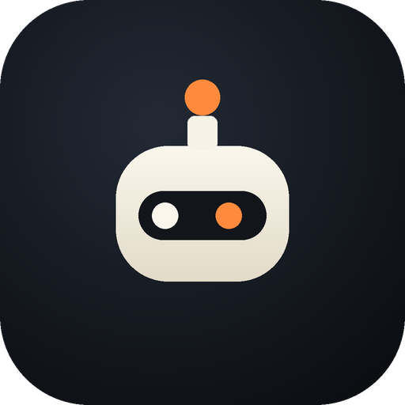
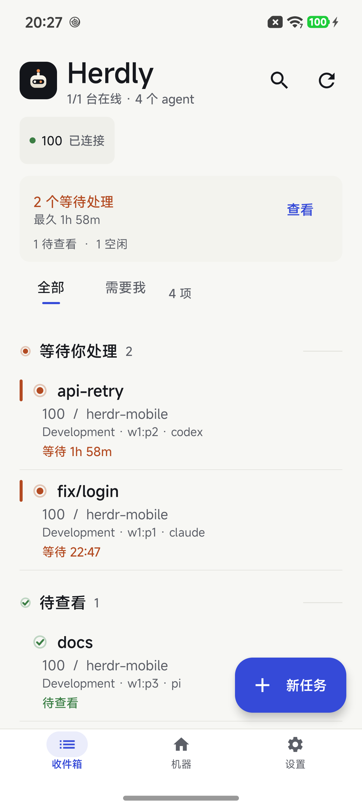
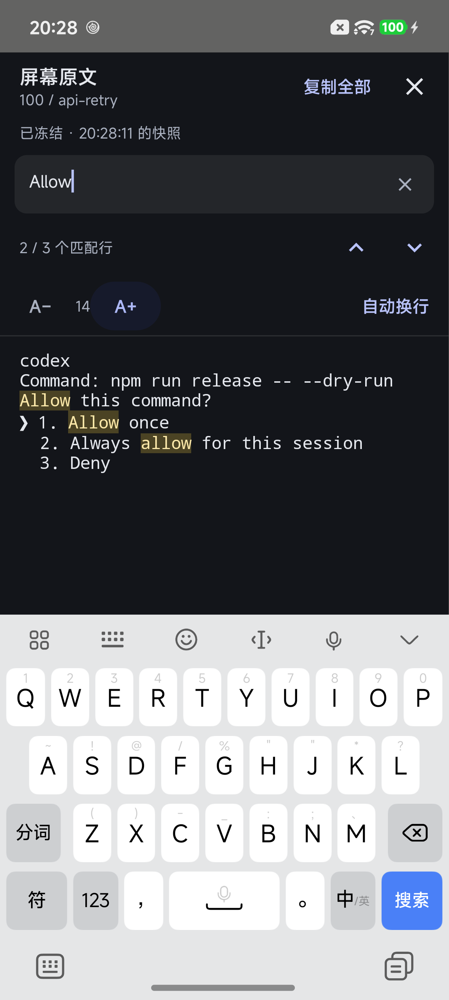

# Herdly

Android 上的 Herdr 客户端，通过 SSH 将多台机器上的 agent 汇集到一个收件箱。查看等待中的任务、核对屏幕证据、回复或审批，再回到自己的事情。

<br clear="left">

## 功能

- 按注意力分组的多机收件箱，等待最久优先；支持搜索名称、机器、工作区、标签页和分屏 ID。
- 详情逐条导航，保留会话内草稿、阅读位置与暂停状态；断线保留上次快照，可原地重连。
- 完整审批选项，发送前重新核对证据；分别反馈请求接受、屏幕变化和结果待核实。
- 原文阅读器支持查找、匹配行跳转、字号与换行；终端快捷键和短回复。
- 工作区 / 标签页 / 分屏管理，新建任务、启动与续接 agent。
- 密码或私钥认证，本机加密保存凭据与主机指纹。

应用在前台同步，离开后断开连接。没有后台服务、系统通知、云端中继或自动审批。

## 界面

| 收件箱 | 审批详情 | 原文查找 |
| --- | --- | --- |
|  |  |  |

截图来自独立测试版与本地模拟主机，任务内容为测试数据。

## 使用

需要 Android 8.0（API 26）以上，以及可经 SSH 访问、安装了 Herdr 的主机。先在主机确认 bridge 可用：

```sh
herdr remote-api-bridge --check
# herdr-api-bridge-v1
```

构建及安装方式见[开发指南](docs/development.md)。打开应用后添加机器，填写主机、端口、用户名和密码或私钥。Herdr session 可留空；默认通过 `bash -lc` 启动 bridge，主机需提供 Bash，并让登录 shell 能找到 `herdr`。

首次连接记录主机 SHA-256 指纹，后续变化会停止连接；信任新指纹前应通过可信渠道核对。应用的显示名称为 Herdly，包名为 `dev.herdwatch`。

## 使用边界

- 审批解析是启发式；无法识别时保留原文和手动按键。读屏与发键是两次请求，仍有远端状态变化的竞争窗口。
- 请求接受或屏幕变化都不代表任务执行成功。写入结果不确定时不会自动重发，需要核对远端状态。
- 收件箱约每 5 秒同步，详情约每 3 秒尝试读屏；离线显示的是上次快照。原文来自 `pane.read`，不是完整 VT 终端或无限滚动历史。
- 草稿与阅读位置只在会话内保存，进程结束后不恢复；阅读位置是像素偏移，输出替换后可能不再对应同一段文字。
- 移动弱网耗电、完整 TalkBack、API 26 实机、多机复杂竞争与真实审批全链路仍需专门验收。

## 开发与文档

项目使用 Kotlin、Jetpack Compose 和 JSch，主机侧通过 Herdr JSON-RPC bridge 通信。

- [开发指南](docs/development.md)：环境、构建、测试、模拟主机与提交检查。
- [产品说明](docs/product.md)：页面、状态和交互规则。
- [工程说明](docs/engineering.md)：协议、并发、存储、安全及限制。
- [模拟 SSH 工具](tools/README.md)：本地故障场景与传输测试。
- [Herdr API schema](docs/herdr-api-schema.json)：字段参考；实际能力以所连接 Herdr 版本为准。
