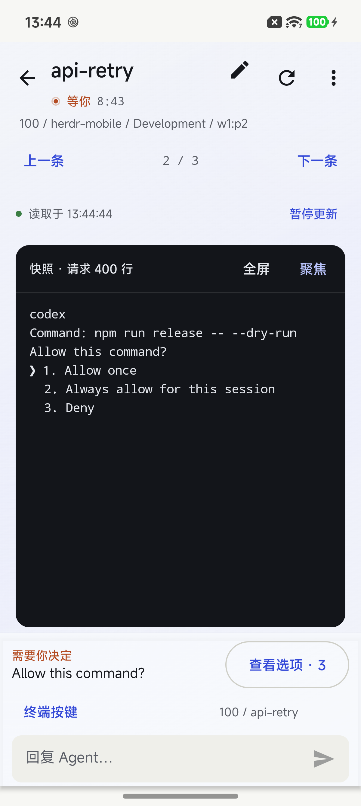
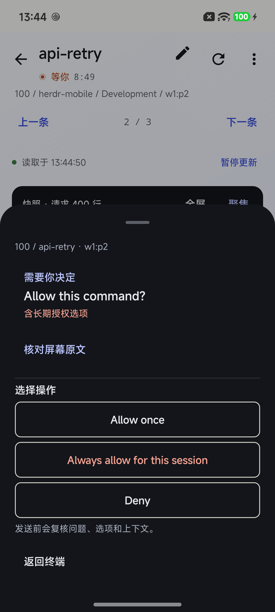
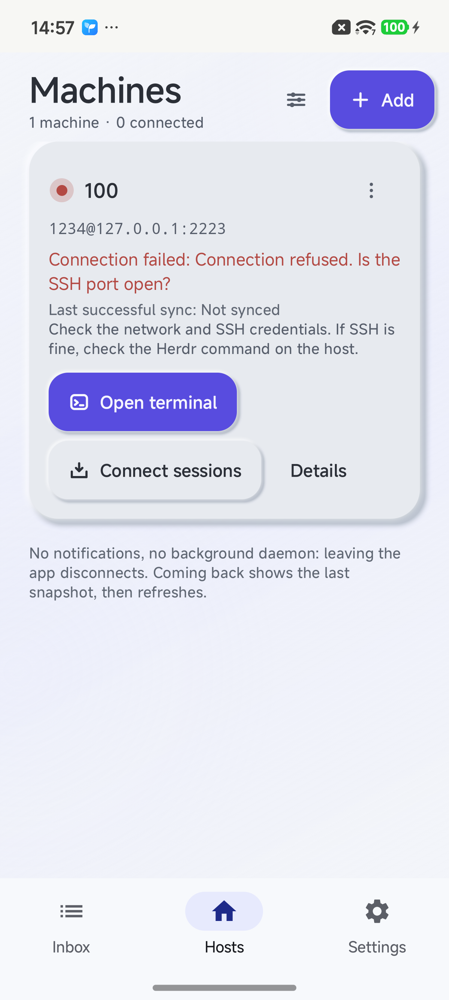
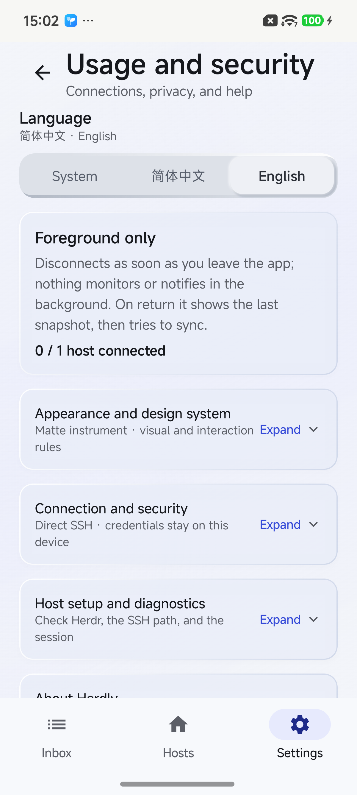

# Herdly

Android 上的 SSH 客户端，并且能读懂你的 AI agent 现在需要什么。先是一台好用的手机终端，再把多台机器上等待中的 Herdr agent 汇到一个收件箱：核对屏幕证据、回复或审批，然后回到自己的事情。

<br clear="left">

## 功能

- 交互式 SSH 终端：等宽网格、两行按键栏（含 Shift+Tab、长按连发）、行输入 / 直通两种模式、长行横向滚动、选择复制、字号可调并被记住。
- 按注意力排序的多机队列，等待最久优先；支持主机范围筛选及名称、工作区、标签页、分屏 ID 搜索。
- 详情逐条导航，保留会话内草稿、阅读位置与暂停状态；断线保留上次快照，可原地重连。
- 终端优先的详情页，固定回复与审批入口；完整选项在底部面板展示，发送前重新核对证据。
- 最近快照可请求 400 / 1200 行，会话内按 agent 记忆；原文阅读器支持查找、匹配行跳转、字号与换行。
- 哑光仪器风格的自绘设计系统，明暗两套；终端保持不透明高对比。小屏、1.3 倍字体和键盘弹出时自动紧凑布局。
- 工作区 / 标签页 / 分屏管理，新建任务、启动与续接 agent。
- 密码或私钥认证，本机加密保存凭据与主机指纹；首次连接的指纹必须由你确认。
- 简体中文与英文双语界面，可在设置里单独切换（Android 13+），无障碍描述同样本地化。
- 偏好持久化：语言、主题、动效、密度、终端字号、快照行数、按键栏与输入模式；可手动检查 GitHub Release 更新。

应用在前台同步，离开后断开连接。没有后台服务、系统通知、云端中继或自动审批。

## 界面

| 值守队列 | 终端详情 | 审批面板 |
| --- | --- | --- |
|  |  |  |

| 终端 | 机器 | 设置（English） |
| --- | --- | --- |
|  |  |  |

截图来自独立测试版与本地模拟主机，任务内容为测试数据；英文界面为同一版本切换语言后的结果。

## 使用

需要 Android 8.0（API 26）以上，以及可经 SSH 访问、安装了 Herdr 的主机。先在主机确认 bridge 可用：

```sh
herdr remote-api-bridge --check
# herdr-api-bridge-v1
```

构建及安装方式见[开发指南](docs/development.md)。打开应用后添加机器，填写主机、端口、用户名和密码或私钥。Herdr session 可留空；默认通过 `bash -lc` 启动 bridge，主机需提供 Bash，并让登录 shell 能找到 `herdr`。

首次连接会中止并展示主机 SHA-256 指纹，确认后才发送凭据并保存；后续指纹变化会停止连接，信任新指纹前应通过可信渠道核对。应用的显示名称为 Herdly，包名为 `dev.herdwatch`。

## 使用边界

- 审批解析是启发式；无法识别时保留原文和手动按键。读屏与发键是两次请求，仍有远端状态变化的竞争窗口。
- 请求接受或屏幕变化都不代表任务执行成功。写入结果不确定时不会自动重发，需要核对远端状态。
- 收件箱约每 5 秒同步，详情约每 3 秒尝试读屏；离线显示的是上次快照。原文来自 `pane.read`，不是完整 VT 终端或无限滚动历史。
- 草稿与阅读位置只在会话内保存，进程结束后不恢复；阅读位置是像素偏移，输出替换后可能不再对应同一段文字。
- 移动弱网耗电、完整 TalkBack、API 26 实机、多机复杂竞争与真实审批全链路仍需专门验收。

## 开发与文档

项目使用 Kotlin、Jetpack Compose 和 JSch，主机侧通过 Herdr JSON-RPC bridge 通信。

- [开发指南](docs/development.md)：环境、构建、测试、模拟主机与提交检查。
- [产品说明](docs/product.md)：定位、信息架构、每页职责与验收标准（范围的唯一权威）。
- [工程说明](docs/engineering.md)：协议、并发、存储、安全及限制。
- [模拟 SSH 工具](tools/README.md)：本地故障场景与传输测试。
- [视觉与交互方向](docs/design/style-direction.md)：配色、材质、动效、组件与无障碍规范（视觉的唯一权威）。
- [Herdr API schema](docs/herdr-api-schema.json)：字段参考；实际能力以所连接 Herdr 版本为准。
