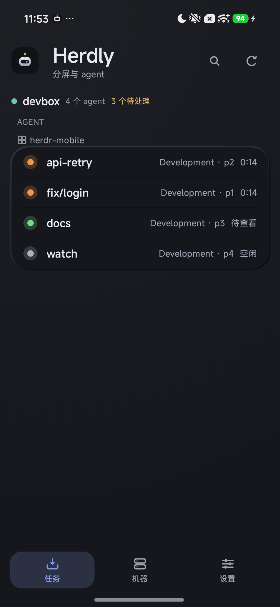
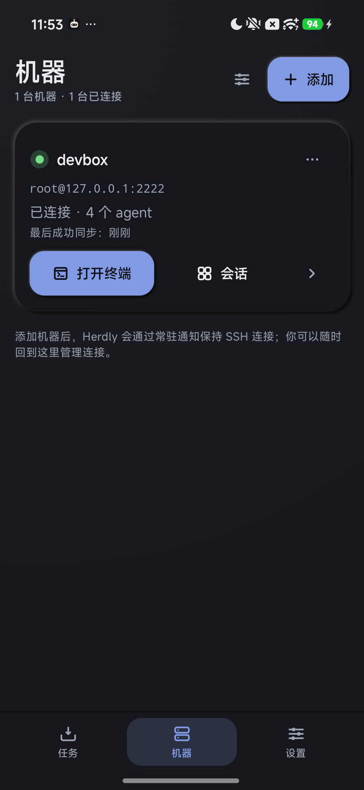
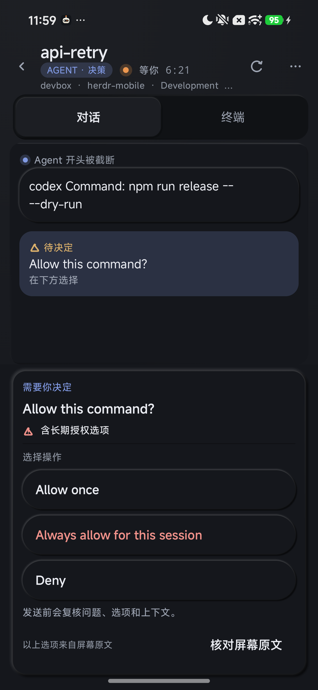
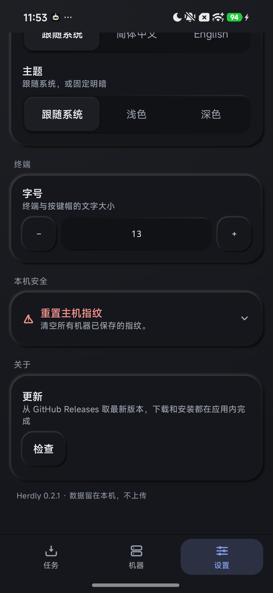

# Herdly

一台手机上的 SSH 客户端：连自己的机器、跑命令、盯着远端 agent，并在它需要你拍板时把决定递到眼前。

- 先是一个**能用的终端**：真实 PTY、颜色、窗口尺寸、断线重连、两排按键、全屏程序（vim / less / tmux）正常显示，输入直接进 PTY，中文候选只在确认时发送。
- 再是一层 **agent 值守**：通过远端 `herdr` 的 JSON-RPC 桥读取分屏，把 agent 的输出读成对话，把审批做成一张能核对原文的卡片。
- 数据只在本机：主机与凭据加密保存，主机密钥首次连接必须由你确认。有机器连着时会以后台服务保持连接，并在通知栏说明连接了几台、有多少待处理；断开最后一台机器，服务与通知一起消失。没有云端、没有账号、没有遥测。

## 界面

| 页面 | 做什么 |
| --- | --- |
| 任务（首页） | 一台机器一块：主机名、在线状态、`N 个 agent、M 个分屏`、待处理数，块内先 agent 后分屏；块间用极淡的分割线，机器按待处理与活跃度排序。宽屏 / 横屏拆成左右两栏（左 agent、右分屏）。 |
| 机器 | 每台机器一张卡：**打开终端** 与 **会话**，右侧箭头展开连接诊断。添加、编辑、删除、指纹核对都在这里。 |
| 会话 | 工作区 / 标签页 / 分屏的增删改，分组可收起；新建时可选目标工作区与起始目录（带最近用过的目录）。页头图标进入只读的结构浏览。 |
| Agent 详情 | 对话模式：按轮次拆分的消息、可折叠的工具与思考、超长回复折叠、内联审批卡；终端模式：整屏网格 + 按键栏。上滑到顶静默取更早的内容。 |
| 终端 | 整机会话，与分屏终端共用同一套输入、按键与渲染。 |
| 设置 | 只放习惯：语言、主题、终端字号；本机安全里的重置指纹；关于里的版本与**应用内更新**（下载、校验、交给系统安装器）。 |

 

 

## 构建

```bash
./gradlew :app:testDebugUnitTest :app:assembleDebug
```

需要 JDK 17 或 21（字节码目标 17）与 Android SDK 35。签名发布见 [docs/development.md](docs/development.md)。

## 文档

- [docs/product.md](docs/product.md)：产品范围、每页职责与验收口径（唯一权威）。
- [docs/design/interaction-spec.md](docs/design/interaction-spec.md)：路由、页面骨架、对话/终端两种模式的交互契约。
- [docs/design/style-direction.md](docs/design/style-direction.md)：自绘设计系统的材质、色板、排版与动效。
- [docs/engineering.md](docs/engineering.md)：分层、协议约束、并发与安全边界。
- [docs/development.md](docs/development.md)：本地夹具、真机验证与发布流程。
